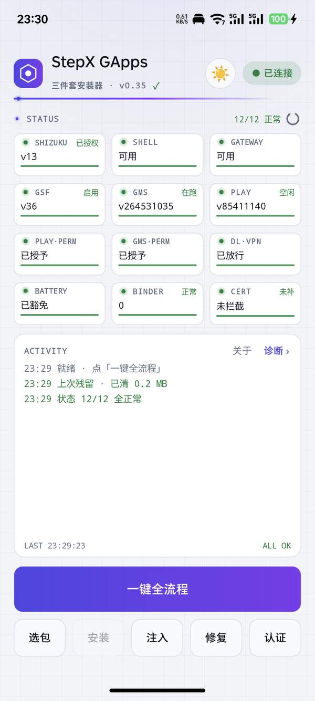

# StepX GApps 安装器

在 StepX Neo（PZ261A / Android 16 / StepOS）上装 Google 三件套 —— GSF + GMS + Play 商店 —— 并把特权权限注入 `system_server`，让 Play 能登录、下载、更新。

全程在手机上完成，不需要电脑。

> 自用工具，不是 STEPX 官方应用，与 Google 无关。三件套版权归 Google；本应用只按原厂签名取用，不重打包、不重签名。



## 为什么需要它

GMS 以普通应用身份运行，拿不到 priv-app 才有的 `MANAGE_USERS` / `OBSERVE_GRANT_REVOKE_PERMISSIONS`，起来十几秒就因 `SecurityException` 死掉。所以装完还要注入特权权限。

## 前提

| 项 | 要求 |
|---|---|
| 设备 | StepX Neo（PZ261A），Android 16 / StepOS |
| 提权通道 | [Shizuku](https://shizuku.rikka.app/) |
| 网络 | 只在「在线获取」时需要，约 133 MiB |

Shizuku 用无线调试自行激活，不需要电脑。

## 用法

打开 Shizuku 并授权后：

1. **选包 → 在线获取**：自动下三个包，装完即清；或者 **选包 → 去选包**：用自己的文件（`.apk` / `.apkm` 都收，三个一次选齐）。
2. **一键全流程**：自检 → 装包 → 部署 → 注入 → 核对。第一次走这个。
3. 面板 12 格全绿即可打开 Play 登录。之后 GMS 若被 Play 更新过，重新点「注入」。

| 按钮 | 什么时候点 |
|---|---|
| 一键全流程 | 第一次部署，或者全来一遍 |
| 安装 | 已选好包，只装不注入 |
| 注入 | 装完包之后；权限被清之后 |
| 修复 | 运行中出问题，走一遍自愈（重新注入） |
| 认证 | Play 弹「设备未获得保护机制认证」时点开：修补拦截清单 / 回滚补丁 |

面板右上角直接给结论：`12/12 正常` / `11/12 需修复` / `11/12 需重新注入`。

**CERT 被拦怎么办**：点底部的「认证」→「修补认证拦截」。会停掉 Play、重启一次注入容器，
把 Play 本地那份「未认证设备要拦哪些页面」的清单清空，约 20 秒。
它只关本地拦截页 —— 搜索、Play Pass、结账是服务端判定，补丁管不了。
失败或反悔时用同一个窗口里的「回滚到打补丁之前」，把 cache 和 phenotype.db 恢复原样。

`CERT` 只说此刻拦不拦（注脚补一个 `已补` / `未补`）；第一行最右的 `GATEWAY` 报容器网关通不通。
网关不通意味着部署、注入、认证修补全都做不了（装包不受影响），右上角会直接写
`网关不通 · 只能装包`，不再假装 12/12 全绿。上次补丁的准确时间在诊断里。

## 三件套从哪来

**在线获取**：从 MindTheGapps 的 release zip 走 HTTP Range 只取三个文件（523.9 MB → 133.2 MB）。
下载源就在「选包」窗口里选：GitHub 直连，或经 gh-proxy 加速（第三方中转，包内容仍校验 sha256）。
下载进度在活动区同一行刷新，不刷屏。

**自己下**：同一个「选包」窗口里列着三个验证过的版本，点条目直接去下载页：

| 包 | 版本 |
|---|---|
| Google Services Framework | 16-15304122 |
| Google Play services | 26.44.63（260400） |
| Google Play Store | 54.1.11（34-0 PR） |

同页还有 MindTheGapps 整套入口（版本偏旧）。APKMirror 有 Cloudflare 校验，只能人工用浏览器下。

## 构建

不需要 Gradle。

```bash
# 需要 JDK 17 + Android SDK（build-tools + 任一 android.jar）
export ANDROID_HOME=$HOME/Android/Sdk
./build.sh                                # → out/stepx-gapps-installer.apk
./build.sh --install                      # 构建完装到连着的设备
VERSION_CODE=30 VERSION_NAME=0.30 ./build.sh
```

Shizuku 的 `api` / `provider` 两个 aar 首次运行自动下到 `.deps/`。

`.github/workflows/build.yml`：push / tag / 手动触发构建，产物作为 artifact 上传；打 `v*` tag 时挂到 Release。

没给签名 key 时脚本会现生成一把临时的，产物能装，但盖不掉已装版本。

## 诊断

「诊断」页导出文本报告：设备指纹、Shizuku 状态、12 格状态、shell 探测结果、已选包与签名、日志。报问题贴这份。

## 已知限制

- 只支持 StepX Neo（PZ261A）；OTA 后哈希与偏移会变，自检会拦住。
- 注入改的是内存态，重启即失效（开机脚本会补，OTA 后要重新部署）。
- GMS 偶尔因 `Not the approved domain verification agent` 掉一次进程（数小时一次），自行恢复。
- 认证修补只改 Play 的本地拦截清单：搜索、Play Pass、结账仍会被服务端拒绝；
  Play 清数据或服务端刷回之后需要重新修补（`CERT` 红了就补）。

## 许可

AGPL-3.0-only。注入链路源自 [xydzf520/stepx](https://github.com/xydzf520/stepx)（AGPL-3.0-only），文件级来源见 `NOTICE`。
